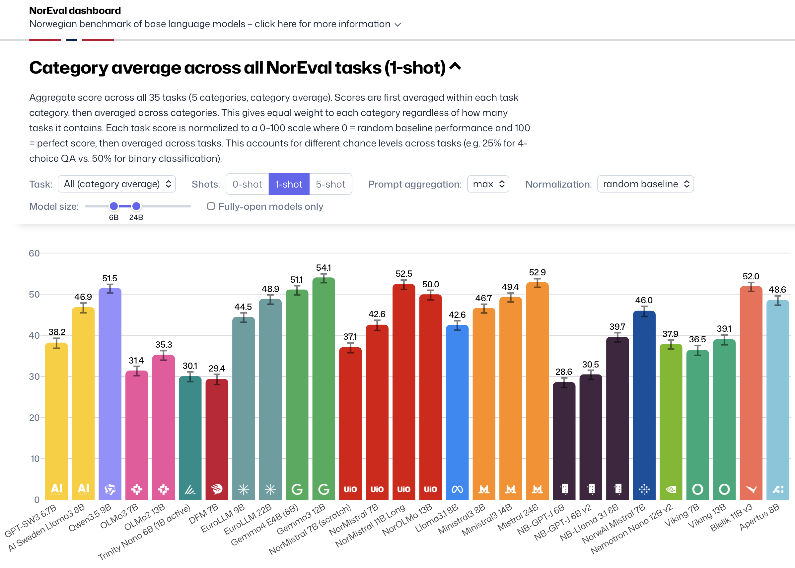

# 🇳🇴 NorEval

NorEval is a multi-task Norwegian language understanding and generation evaluation benchmark. 

### 🔥 Updates
* **`10.11.2026`**: 🧩 We release [NorEval v1.2](https://github.com/ltgoslo/noreval/releases/tag/v1.2), which evaluates every multiple-choice task in three formulations (cloze, hybrid and multiple choice), adds new metrics and samples the generation tasks.
* **`03.11.2026`**: 📌 We release [NorEval v1.1.1](https://github.com/ltgoslo/noreval/releases/tag/v1.1.1), which pins every dataset to a fixed version for reproducible evaluation and fixes the Tatoeba English ↔ Bokmål/Nynorsk tasks.
* **`17.10.2026`**: 🆕 We release [NorEval v1.1](https://github.com/ltgoslo/noreval/releases/tag/v1.1) with new tasks (SLIDE, NoCoLA, MultiBLiMP, NorOpenBookQA without facts, Bokmål ↔ Nynorsk and Bokmål ↔ Northern Sámi translation) and updated task configs.
* **`15.10.2026`**: 📊 Our interactive dashboard is available [here](https://ltgoslo.github.io/llm-dashboard/noreval/).
* **`16.05.2025`**: 🎉 Our paper is accepted to [ACL 2025 Findings](https://2025.aclweb.org/program/find_papers/).
* **`07.05.2025`**: 🫰 NorEval is now integrated into [LM Evaluation Harness](https://github.com/EleutherAI/lm-evaluation-harness/tree/main/lm_eval/tasks/noreval).
* **`10.04.2025`**: 📕 Our pre-print is available on [arXiv](https://arxiv.org/abs/2504.07749).
* **`09.04.2025`**: 🚀 We release [NorEval v1.0](https://github.com/ltgoslo/noreval/releases/tag/v1.0), including our [annotation guidelines](./guidelines/) and novel datasets ([NorRewrite-Instruct](https://huggingface.co/datasets/ltg/norrewrite-instruct) & [NorSummarize-Instruct](https://huggingface.co/datasets/ltg/norsummarize-instruct)).

### 📖 Contents

- [Overview](#-overview)
- [Dashboard](#-dashboard)
- [Tasks](#️-tasks)
- [How to use](#‍-how-to-use)
- [Annotation guidelines and tools](#-annotation-guidelines-and-tools)
- [Citation](#-citation)

### 😎 Overview

NorEval is a multi-task Norwegian language understanding and generation evaluation benchmark that combines existing peer-reviewed datasets with new datasets manually created from scratch ([NCB](https://huggingface.co/datasets/hcfa/ncb), [NorRewrite-Instruct](https://huggingface.co/datasets/ltg/norrewrite-instruct), [NorSummarize-Instruct](https://huggingface.co/datasets/ltg/norsummarize-instruct) for Norwegian Bokmål, and [NorIdiom](https://huggingface.co/datasets/Sprakbanken/Norwegian_idioms) for Norwegian Bokmål and Nynorsk). NorEval covers diverse task categories: sentiment analysis, Norwegian language knowledge, Norwegian-specific \& world knowledge, machine reading comprehension, commonsense reasoning, machine translation, text summarization, instruction following, and truthfulness. Our main evaluation principles are:

- 🌐 **Linguistic diversity**: support for both of the official written standards of Norwegian: Bokmål and Nynorsk (the minority variant).
- 📊 **Task diversity**: coverage of various least addressed tasks for Norwegian. In particular, only three out of 24 NorEval datasets are included in existing Norwegian benchmarks to date: [NorBench](https://aclanthology.org/2023.nodalida-1.61/), [NLEBench](https://aclanthology.org/2024.emnlp-main.317/), [ScandEval](https://aclanthology.org/2023.nodalida-1.20/), and [SEB](https://proceedings.neurips.cc/paper_files/paper/2024/file/4746bb91bd073ec7eef930d5775122ba-Paper-Datasets_and_Benchmarks_Track.pdf).
- 🧠 **Data quality**: focus on only peer-reviewed human-created datasets to ensure reliable evaluation in the context of the Norwegian language, culture, and values.
- 📏 **Prompt sensitivity**: evaluation across multiple human-written prompts to account for the prompt sensitivity.
- 👩🏻‍🔬 **Standardized evaluation**: integration of NorEval into LM Evaluation Harness for flexible and reproducible evaluation.


### 📊 Dashboard

Explore the results of benchmarking Norwegian and multilingual models on NorEval in our [interactive dashboard](https://ltgoslo.github.io/llm-dashboard/noreval/). The dashboard lets you compare models on individual tasks or category averages across 0-shot, 1-shot, and 5-shot regimes, choose how the scores are aggregated over prompts and normalized, and filter models by size or by whether they are fully open.

[](https://ltgoslo.github.io/llm-dashboard/noreval/)

### 🗃️ Tasks

The task names end with the language code: `nob` (Bokmål), `nno` (Nynorsk), `sme` (Northern Sámi), `eng` (English); a translation task name lists the source language first. Each name runs all prompts of the task and, for multiple-choice tasks, all task formulations.

| Dataset | Tasks | Type |
|:---|:---|:---|
| **Linguistic knowledge** | | |
| [NCB](https://huggingface.co/datasets/hcfa/ncb) | `ncb_nob` | Multiple choice |
| [NoCoLA](https://huggingface.co/datasets/ltg/nocola) | `nocola_nob` | Multiple choice |
| [SLIDE](https://huggingface.co/datasets/ltg/slide) | `slide_nob_nno_swe_dan` | Multiple choice |
| [MultiBLiMP](https://huggingface.co/datasets/jumelet/multiblimp) | `multiblimp_noreval_sme` | Multiple choice |
| [NorIdiom](https://huggingface.co/datasets/Sprakbanken/Norwegian_idioms) | `noridiom_nob`, `noridiom_nno` | Generation |
| [ASK-GEC](https://huggingface.co/datasets/ltg/ask-gec) | `ask_gec_nob` | Generation |
| **Language understanding** | | |
| [NoReC Sentence](https://huggingface.co/datasets/ltg/norec_sentence) | `norec_sentence_nob` | Multiple choice |
| [NoReC Document](https://huggingface.co/datasets/ltg/norec_document) | `norec_document_nob` | Multiple choice |
| [NorOpenBookQA](https://huggingface.co/datasets/ltg/noropenbookqa) | `noropenbookqa_nob`, `noropenbookqa_nno` | Multiple choice |
| [NorBelebele](https://huggingface.co/datasets/ltg/norbelebele) | `norbelebele_nob` | Multiple choice |
| [NorQuAD](https://huggingface.co/datasets/ltg/norquad) | `norquad_nob` | Generation |
| **World knowledge & reasoning** | | |
| [NRK-Quiz-QA](https://huggingface.co/datasets/ltg/nrk_quiz_qa) | `nrk_quiz_qa_nob`, `nrk_quiz_qa_nno` | Multiple choice |
| [NorOpenBookQA (without facts)](https://huggingface.co/datasets/ltg/noropenbookqa) | `noropenbookqa_no_fact_nob`, `noropenbookqa_no_fact_nno` | Multiple choice |
| [NorCommonsenseQA](https://huggingface.co/datasets/ltg/norcommonsenseqa) | `norcommonsenseqa_nob`, `norcommonsenseqa_nno` | Multiple choice |
| [NorTruthfulQA](https://huggingface.co/datasets/ltg/nortruthfulqa_mc) | `nortruthfulqa_mc_nob`, `nortruthfulqa_mc_nno` | Multiple choice |
| [NorTruthfulQA](https://huggingface.co/datasets/ltg/nortruthfulqa_gen) | `nortruthfulqa_gen_nob`, `nortruthfulqa_gen_nno` | Generation |
| **Generation & summarization** | | |
| [NorSumm](https://huggingface.co/datasets/SamiaT/NorSumm) | `norsumm_nob`, `norsumm_nno` | Generation |
| [NorRewrite-Instruct](https://huggingface.co/datasets/ltg/norrewrite-instruct) | `norrewrite_instruct_nob` | Generation |
| [NorSummarize-Instruct](https://huggingface.co/datasets/ltg/norsummarize-instruct) | `norsummarize_instruct_nob` | Generation |
| **Translation** | | |
| [NorSumm Translation](https://huggingface.co/datasets/ltg/norsumm-nob-nno-translation) | `translation_nob_nno`, `translation_nno_nob` | Generation |
| [Tatoeba](https://huggingface.co/datasets/Helsinki-NLP/tatoeba_mt) | `translation_eng_nob`, `translation_nob_eng`, `translation_eng_nno`, `translation_nno_eng` | Generation |
| [Sámi Tatoeba](https://huggingface.co/datasets/ltg/saami-tatoeba) | `translation_nob_sme`, `translation_sme_nob` | Generation |

### 👨🏻‍💻 How to use

The tasks are plain [LM Evaluation Harness](https://github.com/EleutherAI/lm-evaluation-harness) configs, meaning no fork of the `lm-evaluation-harness` is needed. Install the harness, clone this repository, and point the harness to it with `--include_path`:

```bash
pip install lm-eval  # or lm-eval[vllm] for the vLLM backend
git clone https://github.com/ltgoslo/noreval.git
```

Example: zero-shot evaluation on NorQuAD across all five prompts:

```bash
lm_eval \
  --model hf \
  --model_args pretrained=norallm/normistral-7b-warm \
  --include_path noreval \
  --tasks norquad_nob \
  --output results/norquad_nob/0-shot/ \
  --show_config \
  --write_out \
  --batch_size auto \
  --num_fewshot 0
```

* The task names in the table above run all variants of a task at once. To run a single variant, append the prompt index (e.g. `norquad_nob_p2`); for multiple-choice tasks, also add the task formulation, `cf`, `hybrid` or `mcf` (e.g. `norbelebele_nob_mcf_p2`, or `norbelebele_nob_mcf` for all prompts of one formulation).
* Tasks loaded via `--include_path` take precedence over any same-named NorEval tasks bundled with the harness, so this repository is the source of truth for the task definitions.


### 🧰 Annotation guidelines and tools

* [`guidelines/`](./guidelines/): the annotation guidelines for the human baselines, prompt writing, and the creation of NorRewrite-Instruct and NorSummarize-Instruct.
* [`tools/`](./tools/): example task groups for aggregating results by category and a script for processing and plotting the results.
* [`noreval_metadata.json`](./noreval_metadata.json): the category, language(s), primary metric, random baseline and maximum score of each task, with the names of its variants (e.g., for min-max normalization and grouping). It is generated from the task configs with [`tools/build_metadata.py`](./tools/build_metadata.py).


### 📝 Citation

```bibtex
@inproceedings{mikhailov-etal-2025-noreval,
    title = "{N}or{E}val: A {N}orwegian Language Understanding and Generation Evaluation Benchmark",
    author = "Mikhailov, Vladislav  and
      Enstad, Tita  and
      Samuel, David  and
      Farseth{\r{a}}s, Hans Christian  and
      Kutuzov, Andrey  and
      Velldal, Erik  and
      {\O}vrelid, Lilja",
    editor = "Che, Wanxiang  and
      Nabende, Joyce  and
      Shutova, Ekaterina  and
      Pilehvar, Mohammad Taher",
    booktitle = "Findings of the Association for Computational Linguistics: ACL 2025",
    month = jul,
    year = "2025",
    address = "Vienna, Austria",
    publisher = "Association for Computational Linguistics",
    url = "https://aclanthology.org/2025.findings-acl.181/",
    doi = "10.18653/v1/2025.findings-acl.181",
    pages = "3495--3541",
    ISBN = "979-8-89176-256-5",
}
```
